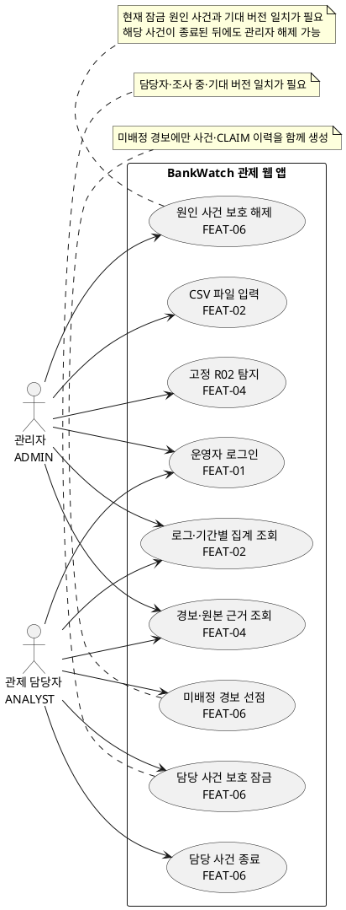
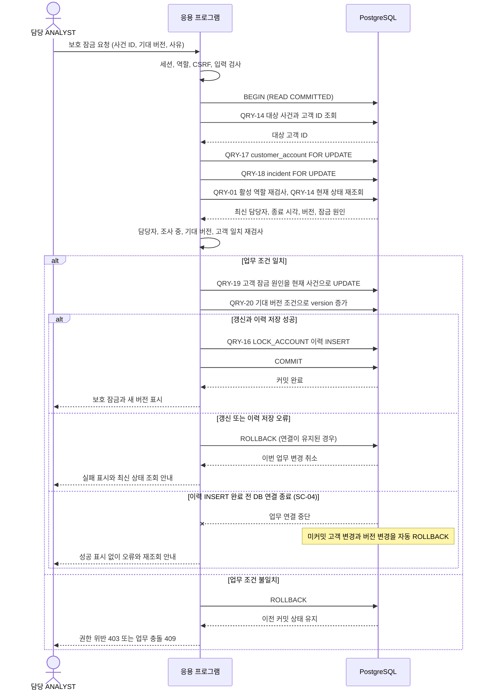
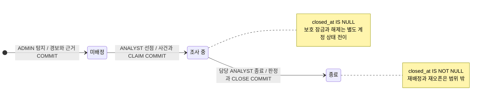
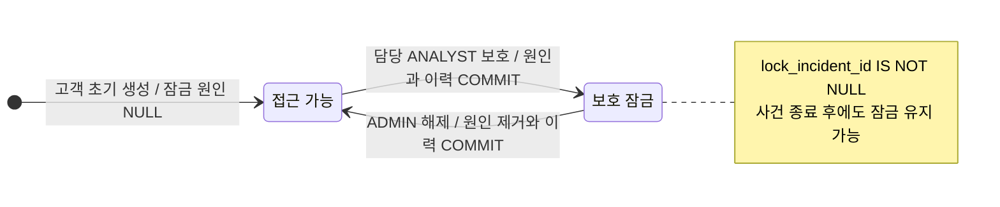

# 사용자 시나리오 — BankWatch

| 항목 | 내용 |
|---|---|
| 팀명 | BankWatch |
| 이름 / 학번 | 이우석 / 2022112052 |
| 제출일 | 2026-11-29 — 사용자 지정 제출일, 실제 제출 여부는 별도 |
| 공식 문서 버전 | v1.10 |
| 검토일 | 2026-11-19 KST |
| 검토 근거 | 실제 Windows B1 빌드·B2 PostgreSQL/JAR HTTP 증거. 앱 main 신규 커밋·push와 실제 제출은 미실행 |

## 1. 프로젝트 개요

BankWatch는 가상 모바일뱅킹 인증 서버가 로그인 결과를 확정할 때 생성한 고객 식별자, 발생 시각, 이벤트 ID, 기기 식별자, 성공·실패 및 성공 당시 신규 기기 여부를 UTF-8 CSV로 받아 분석하는 1인 PostgreSQL 과제다.
정상 고객의 휴대폰 교체도 신규 기기 성공으로 나타나므로, 성공 한 건만으로 사고를 단정하지 않고 같은 고객의 고정 10분 구간에서 그 성공보다 앞선 실패 기록을 함께 살핀다.
R02는 선행 실패가 5건 이상인 신규 기기 성공을 조사 후보로 찾으며, 실제 사고 여부는 관제 담당자의 모의 본인 확인과 종료 판정으로 구분한다.
데이터베이스는 원본 로그와 경보 근거, 사건 담당자, 가상 계정 보호 원인 및 조치 이력을 연결하여 탐지 이유를 재현하고, 동시 요청이나 처리 중단에도 반쪽 변경이 남지 않도록 한다.

## 2. 사용자

| 사용자 | 설명 | 조회·변경 권한 |
|---|---|---|
| 관리자 `ADMIN` | 로그를 수집하고 탐지를 실행하며 보호 해제를 승인하는 운영자 | 로그·집계·경보·근거·사건·이력 조회, CSV 입력, R02 탐지, 현재 잠금 원인 사건에서 사유·버전을 확인한 계정 보호 해제 |
| 관제 담당자 `ANALYST` | 경보를 조사하고 자신이 맡은 사건을 처리하는 운영자 | 공통 조회, 미배정 경보 선점, 자신이 담당한 조사 중 사건의 보호 잠금·종료. CSV 입력·탐지·보호 해제는 불가 |
| 가상 고객 | `C1001` 등의 로그 분석 대상 | 관제 화면 로그인 계정이 아니다. 실제 고객 인증·이체·은행 계정 제어 기능은 없다 |

가상 인증 서버는 CSV의 출처이며 관제 웹 앱의 로그인 사용자가 아니다. `is_new_device`는 성공 당시 원본 서버가 제공한 사실을 사용한다.
운영자는 활성 상태와 BCrypt 비밀번호 검증을 거쳐 세션으로 식별한다. 서버는 역할·CSRF·대상별 담당자 권한을 검사하고, `actor_id`는 요청 폼 대신 세션에서 얻는다.
브라우저의 HTML 업무 방문은 로그인 화면으로 안내하며, JSON 업무 요청은 입력 오류 400, 미인증 401, 권한·CSRF 위반 403, 대상 없음 404, 이미 선점·보호되었거나 오래된 버전 409로 구분한다. 파일 크기 초과는 413이다. 연결 종료503은 이번 Windows B2 HTTP로 확인했다. Windows 브라우저503 화면 조작은 미실행이다.

### 2.1 유스케이스 다이어그램

다음은 현재 승인된 기능 범위의 유스케이스 다이어그램 1개다. 로그인은 공통 진입점이며 각 업무 요청에서도 서버 권한 검사를 수행한다.



## 3. 시나리오

화면 진입점은 `/`이고 업무는 세션·CSRF를 사용하는 JSON/CSV API다. 아래 화면 행동은 구현 흐름이며 이번 Windows에서는 실제 인증 HTTP로 검증했다.

### SC-01. 정상 탐지와 대응

| 항목 | 내용 |
|---|---|
| 사용자 | admin / analyst_a |
| 발생 상황·사전 조건 | C1001의 반복 실패 뒤 신규 기기 성공. 운영자3·고객3·R02·11월 파티션 준비, 대상 원본/경보 없음 |
| 가상 입력 | events-r02.csv 7건: 실패ID1~5 10:00:30~10:04, 신규 성공ID6 10:05·ID7 10:07, 2026-11-02 KST |
| 화면 행동 | 로그 CSV 입력→재입력→10:00~10:10 탐지→상세 근거→맡기→보호→ADMIN 해제→담당자 CONFIRMED 종료 |
| 서버 처리 | 입력은 고객 SELECT→원본 INSERT. REPEATABLE READ CTE/윈도우 R02, UNIQUE 신규 경보와 근거6 원자 저장. 사건0→보호1→해제2→종료3, 조치마다 이력 동시 저장 |
| 조회·변경 테이블 | 조회: 8테이블. 변경: security_event·alert·alert_event·incident·customer_account.lock_incident_id·incident_history |
| 트랜잭션·실패 시 DB 상태 | 입력/탐지/각조치는 별도 업무 트랜잭션. 요청 실패는 전체 롤백, 앞선 커밋 유지 |
| 기대 및 실제 결과 | 후보2·대표6·경보1·근거6, 재탐지 신규0/기존1·추가근거0. 최초입력7·재입력신규0/중복7. 이력4·version3/CLOSED/ACTIVE |
| 관련 REQ | REQ-01, REQ-02, REQ-04, REQ-05, REQ-07, REQ-08, REQ-09, REQ-15 |

실제 결과: WINDOWS-B2 report.json의 해당 SC. Windows 버튼 조작 시험과 구분한다.

### SC-02. 동시 선점과 오래된 버전

| 항목 | 내용 |
|---|---|
| 사용자 | 서로 다른 analyst_a/analyst_b; 버전 시험은 승자 한 명의 독립 로그인 두 세션 |
| 발생 상황·사전 조건 | 같은 미배정 경보 경쟁. C1002 경보/근거 커밋, 사건 없음·접근 가능 |
| 가상 입력 | 정상 CSV 고객C1002·ID20~26·시각+10분. 두 claim {}, 승자 두 보호 요청 version0·각 사유, 뒤 구버전 종료0 |
| 화면 행동 | 두 담당자가 맡기를 겹쳐 요청→승자 독립 두 화면의 보호→구버전 종료→최신 조회 |
| 서버 처리 | 각 세션의 활성 ANALYST 확인. 경보 한 행 잠금 QRY13 후 별도 QRY14 SELECT. 승자만 사건/CLAIM 저장. 조치는 고객→사건 잠금·버전 재검사 후 갱신/이력 |
| 조회·변경 테이블 | 조회: operator_user·alert·incident·customer_account·incident_history. 변경: incident·incident_history·보호 성공 시 고객 원인 |
| 트랜잭션·실패 시 DB 상태 | 선점/버전 각각 BEGIN2·COMMIT1·ROLLBACK1. 패자409·추가사건/이력0, 구버전409·8테이블 불변 |
| 기대 및 실제 결과 | 실제 선점200/409·승자B. 서로 다른 JSESSIONID 두 세션 보호200/409·version1/이력2. 관리자 해제/종료 후version3 |
| 관련 REQ | REQ-01, REQ-06, REQ-07, REQ-16 |

실제 결과: WINDOWS-B2 report.json의 해당 SC. Windows 버튼 조작 시험과 구분한다.

### SC-03. 잘못된 고객 참조와 전부 롤백

| 항목 | 내용 |
|---|---|
| 사용자 | 관리자 admin |
| 발생 상황·사전 조건 | 첫 정상 INSERT 뒤 없는 고객 조회. 기존 원본7·경보/근거 커밋, C9999 없음 |
| 가상 입력 | events-invalid-customer.csv: ID8 C1001 10:08:00, ID9 C9999 10:08:30, 2026-11-02 KST |
| 화면 행동 | 오류 CSV 제출→입력 오류 안내→기존 로그/경보 재조회 |
| 서버 처리 | 정렬한 행별 고객 SELECT→INSERT8 성공→다음 C9999 SELECT0행으로 업무 오류. INSERT9 미실행 |
| 조회·변경 테이블 | 조회: operator_user·customer_account·security_event. 변경 시도: security_event INSERT8. 전체8테이블 지문 관찰 |
| 트랜잭션·실패 시 DB 상태 | 파일 전체 한 트랜잭션. 임시 AFTER INSERT8 장치에서 내부8/외부7 확인 뒤 해제. HTTP400·ROLLBACK |
| 기대 및 실제 결과 | 기존7 유지·신규0·INSERT8시도1/INSERT9시도0·8테이블 복원. 직접 FK23503은 별도 TEST09 |
| 관련 REQ | REQ-01, REQ-02, REQ-16 |

실제 결과: WINDOWS-B2 report.json의 해당 SC. Windows 버튼 조작 시험과 구분한다.

### SC-04. 보호 도중 연결 중단

| 항목 | 내용 |
|---|---|
| 사용자 | 담당자 analyst_a / 별도 verifier |
| 발생 상황·사전 조건 | 고객 보호 원인/사건 버전 UPDATE 뒤 이력 INSERT 전 실제 DB 연결 종료. C1003 사건은 조사중·원인NULL·version0·CLAIM1 |
| 가상 입력 | 정상 CSV 고객C1003·ID30~36·시각+20분 파생7건. version0 보호 요청 |
| 화면 행동 | 보호 요청 대기 중 실제 backend 종료→503 안내→최신 조회→명시적 새 정상 요청 |
| 서버 처리 | 고객→사건 잠금·원인/version1 갱신 뒤 시험 이력 트리거 대기. 별도 비super verifier만 pg_signal_backend로 해당 실제 PID232 종료 |
| 조회·변경 테이블 | 조회: operator_user·alert·incident·customer_account·incident_history. 변경 시도: 고객 원인·사건 version·LOCK_ACCOUNT 이력 |
| 트랜잭션·실패 시 DB 상태 | COMMIT 전 중단. PostgreSQL이 미커밋 트랜잭션 폐기, HTTP503·8테이블 복원·자동재시도0. 관찰장치 제거 후 새 요청만 커밋 |
| 기대 및 실제 결과 | 실패 뒤 원인NULL/version0/CLAIM1. 새 version0 보호200/version1/이력2. 후속해제/종료version3. COMMIT 후 응답 유실은 먼저 재조회 필요 |
| 관련 REQ | REQ-01, REQ-07, REQ-08, REQ-09, REQ-16 |

실제 결과: WINDOWS-B2 report.json의 해당 SC. Windows 버튼 조작 시험과 구분한다.

### 3.1 보호 잠금 트랜잭션 시퀀스

아래는 현재 IncidentActionService의 존재하는 사건에 대한 처리 순서다. 없는 대상은 잠금 전에 404로 처리한다. 성공 화면은 COMMIT 확인 뒤에만 표시한다.



### 3.2 사건 진행 상태 변화도

경보에 연결된 사건이 없으면 **미배정**, 사건이 있고 `closed_at IS NULL`이면 **조사 중**, `closed_at IS NOT NULL`이면 **종료**다. 별도 상태 문자열을 저장·동기화하지 않는다.



| 정상 전이 | 행위자·조건 | 커밋되는 결과 | 실패 요청의 영향 |
|---|---|---|---|
| 경보 없음 → 미배정 | ADMIN, R02 적격 후보·신규 UNIQUE 키·근거 검사 통과 | 경보 1·대표 및 선행 실패 근거, 사건 없음 | 신규 경보·근거 함께 취소 |
| 미배정 → 조사 중 | ANALYST, 경보 잠금 후 사건 부재 | 담당 사건 1·version 0·CLAIM 1 | 해당 요청의 사건·이력 없음. 경쟁 승자가 있으면 재조회 시 조사 중 |
| 조사 중 → 종료 | 담당 ANALYST, 조사 중·기대 버전 일치, 허용 판정·사유 | 종료 시각·판정·version 증가·CLOSE 1 | 이전 사건·계정·이력 유지 |

### 3.3 가상 계정 접근 상태 변화도

`customer_account.lock_incident_id IS NULL`이면 **접근 가능**, 값이 있으면 **보호 잠금**으로 계산한다. 사건 종료는 계정 접근 상태를 자동으로 바꾸지 않는다.



| 정상 전이 | 행위자·조건 | 커밋되는 결과 | 실패 요청의 영향 |
|---|---|---|---|
| 접근 가능 → 보호 잠금 | 담당 ANALYST, 조사 중·버전 일치·같은 고객·현재 원인 NULL | 원인 사건 ID·사건 version 증가·LOCK_ACCOUNT | 접근 가능·시작 버전·기존 이력 유지 |
| 보호 잠금 → 접근 가능 | ADMIN, 요청 사건=현재 원인 사건·고객 일치·버전 일치·사유. 사건 종료 뒤에도 허용 | 원인 NULL·사건 version 증가·UNLOCK_ACCOUNT | 기존 원인·버전·이력 유지 |

권한·버전·업무 조건 거절과 커밋 전 롤백은 새로운 상태 전이를 만들지 않는다. 동시 요청에서는 다른 연결의 커밋 결과를 별도로 반영하여 표시한다.

## 4. 시스템 구조

Java21·Boot4.1.2·Spring JDBC·PostgreSQL16이다. 브라우저→SecurityConfig/Controller→업무Service→Db.tx→DB 흐름이며 actor는 세션에서 얻고 SQL 값은 바인딩한다. v2의 유용한 레이아웃·스타일·요청 구조를 유지하고 R01·규칙 편집·저장 검색·검증 센터를 제거했다.

### 4.1 모델·제약·정규화

별도 `BankWatch_erd.pdf`와 `BankWatch_data_dictionary.md`에 8테이블·44컬럼·PK8/FK10/UQ6/CHECK10·부분UNIQUE1을 대조했다.

| 테이블 | 주요 키·속성 |
|---|---|
| `operator_user` | operator_id PK·login_id UQ·ADMIN/ANALYST·enabled |
| `customer_account` | account_id PK·customer_ref UQ·lock_incident_id 선택UQ/FK |
| `security_event` | (occurred_at,event_id) PK·account FK·KST10/11/12월 RANGE |
| `detection_rule` | rule_id PK·rule_code UQ·R02/600초/5건 |
| `alert` | alert_id PK·rule/account FK·(rule_id,account_id,bucket_start) UQ |
| `alert_event` | (alert_id,event_occurred_at,event_id) PK·원본 전체복합FK·is_anchor=true 최대1 부분UQ |
| `incident` | incident_id PK·alert_id UQ/FK·assignee FK·closed_at/resolution CHECK·version>=0 |
| `incident_history` | history_id PK·incident/actor FK·행동4종/사유 CHECK |

원본 복합PK와 경보 중복 키를 구별한다. 월 경계는 KST 2026-10-01/11-01/12-01/2027-01-01의 [시작,다음월)이며 DEFAULT 파티션이 없다. 신규 기기는 성공에서 필수·실패에서NULL이다. FK는 NO ACTION/NOT DEFERRABLE이며 관계의 수·선택성은 ERD/사전과 같다.

명칭은 고객·규칙·운영자 부모에서 JOIN하며 원본 내용을 근거에 복사하지 않는다. is_anchor는 다른 행/규칙에 의존하는 의도적 파생 중복이므로 엄격한3NF 일괄 통과를 주장하지 않는다. 부분UQ는 최대1만 보장하고 대표 정확히1·같은 고객/구간·선행 실패수·잠금 원인 고객 일치는 서비스 트랜잭션이 검사한다. 사건 유무/closed_at과 계정 lock_incident_id 상태는 독립이다.

### 4.2 실제 QRY·트랜잭션·인덱스

| QRY | 질의 / 트랜잭션·잠금 / 인덱스 |
|---|---|
| QRY-01 | 운영자 인증·활성 역할 조회; 인증 조회는 UserDetailsService 람다. 업무 서비스는 트랜잭션 안에서 활성 역할을 확인하고, 쓰기는 잠금 대기 뒤 재검사한다. login은 로그인명, actor는 Principal에서 얻은 ID.; login_id UQ / operator_id PK. 해시는 인증 내부에서만 사용. 실제 Index Scan 선택 여부는 별도 실측 대상. |
| QRY-02 | 고객 참조 조회; READ COMMITTED 입력 트랜잭션. 각 INSERT 바로 전에 customer로 고객 확인. 두 번째 없는 고객 조회는 앞선 신규 INSERT까지 롤백.; customer_ref UQ. |
| QRY-03 | 복합키 원본 INSERT; 입력 트랜잭션. time/event/account/device/type/newDevice 바인딩. 충돌 대상은 원본 복합키만 지정. 영향 행0이면 QRY-04.; PK(occurred_at,event_id), account FK, 월별 RANGE 라우팅. 다른 CHECK/FK/파티션 오류는 건너뛰지 않음. |
| QRY-04 | 충돌 원본 내용 확인; READ COMMITTED의 새 SELECT. time/event 키로 대기 상대의 커밋 내용을 확인하고 정규화한 내용 비교. ingested_at 제외.; 원본 복합 PK. |
| QRY-05 | 필터·복합 커서 로그 목록; 읽기 전용 REPEATABLE READ. account/type/from/to는 선택 조건; 없으면 해당 AND만 생략. beforeAt/beforeId는 함께 사용. fetchLimit=limit+1(1~100). 값·정렬 종류를 분리한다.; 기간은 원본 occurred_at에 바인딩. PK 설치, 후보(account_id,occurred_at,event_id)는 기본 DDL 미설치. TEST-10에서 시험 중 추가·제거; 파티션1/3/1, 추가 후에도 PK 선택. 현재 입력에서 향상 입증 없음. |
| QRY-06 | 같은 필터의 구간·결과 집계; QRY-05와 같은 읽기 전용 스냅샷. 커서·LIMIT는 집계에 넣지 않는다. account/type/from/to 선택 필터 바인딩. event_count 합계가 total.; 월별 저장·원본 PK. TEST-10에서 같은 필터 집계100 확인. 실행계획 비교 대상은 QRY-05 목록 SQL이며 이 집계 SQL 자체의 인덱스 전후 계획은 미실행. |
| QRY-07 | 고정 R02 정책 확인; 탐지 REPEATABLE READ. 결과가 정확히 R02 한 행·600초·임계5인지 서비스가 검사한다. 바인딩 없음.; rule_id PK / rule_code UQ; app은 SELECT만 허용. |
| QRY-08 | 고정 구간 후보·대표 윈도우; REPEATABLE READ. from/to는 KST10분 경계 [from,to), 최대24시간. threshold=5. EXCLUDE GROUP으로 같은 시각 실패 제외, occurred_at/event_id의 첫 후보 대표 선택.; 기간 제한으로 파티션 제외 가능. CTE·FILTER count OVER·ROW_NUMBER·후보 count OVER. 후보 복합 인덱스 미설치; 성능 실측과 구별. |
| QRY-09 | 신규 경보 저장; rule/account/bucket 바인딩. 탐지 트랜잭션; 신규만 RETURNING. 기존 경보는 최초 detected_at·근거를 보존한다.; UQ(rule_id,account_id,bucket_start)가 최종 중복 방지. 40001/40P01만 Db.tx가 전체 트랜잭션 재시도. |
| QRY-10 | 대표·선행 실패 근거 저장; 신규 경보에만 alert/account/bucket/anchorAt/anchorId로 원본 조회. 전체 복합키 저장, 영향 행수=선행 실패+1. QRY-23 검사와 같은 커밋.; alert_event 복합 PK·원본 복합 FK, alert_id WHERE is_anchor 부분 UQ. 정확히 대표1·고객/시간/종류는 서비스 트랜잭션에서 추가 검사. |
| QRY-11 | 경보 목록·기본 상세 JOIN; 읽기 전용 REPEATABLE READ. actor, fetchLimit=limit+1. account/status/mine/커서 선택 조건은 고정 목록에서 추가. FUNC-10 상세는 동일 SUMMARY+WHERE a.alert_id=:alert (전체 원문은 D셀 주석).; 경보/고객/규칙/운영자 PK, incident.alert_id UQ, alert_event PK(alert_id 선두). 경보 정렬용 추가 인덱스는 설치하지 않음. |
| QRY-12 | 전체 복합키 원본 근거 JOIN; alert 바인딩. 읽기 전용 상세 스냅샷에서 저장된 근거를 원본 시각+ID로 JOIN. 주변 로그를 다시 계산해 섞지 않는다.; alert_event PK의 alert_id 선두 / security_event 복합 PK. 복합 FK와 같은 컬럼 순서. |
| QRY-13 | 경보 한 행 잠금 함수 호출; READ COMMITTED. alert 바인딩. db/schema.sql의 SECURITY DEFINER 함수가 bankwatch.alert 해당 한 행만 FOR UPDATE. true/false 반환. 다음 QRY-14는 별도 문장.; alert PK. 함수 PUBLIC EXECUTE 해제; grant_runtime.sql이 app에만 실행 부여. app에 alert UPDATE/FOR UPDATE 직접 권한을 주지 않음. |
| QRY-14 | 선점·조치 현재 상태 조회; 선점 alert / 조치 incident 바인딩. 조치는 QRY-17→18 후 같은 CURRENT를 다시 읽어 고객·담당자·버전·현재 원인 고객 일치를 검증한다. FUNC-10 상세는 QRY-11/12/22 사용.; incident PK·alert_id UQ, alert/customer PK. 원인 참조는 선택 FK/UQ. 두 변형 모두 현재 소스 그대로. |
| QRY-15 | 담당 사건 생성; READ COMMITTED 선점. alert/actor는 잠금한 대상과 세션 운영자. 반환 사건 ID·배정 ID 문자열화, 초기 version0. CLAIM 이력과 원자 저장.; incident.alert_id UQ / FK, assignee_id FK. 사건과 배정 이력 각각1. |
| QRY-16 | CLAIM·조치 이력 생성; incident/actor/reason, 조치는 action 추가. actor는 세션에서 얻음. CLAIM 사유는 사건 담당자로 배정. 원인·버전/종료 갱신과 같은 트랜잭션; 실패 시 모두 롤백.; history PK, 사건·실행자 FK, action_type/공백 사유 CHECK. 이력 UPDATE/DELETE 권한 없음. |
| QRY-17 | 고객 행 잠금; 조치 READ COMMITTED. account 한 행 FOR UPDATE; 모든 조치는 반드시 고객→사건 순서. 잠금 후 QRY-14 재조회.; customer_account PK. app은 lock_incident_id의 제한 UPDATE로 이 행 잠금 가능. |
| QRY-18 | 사건 행 잠금; QRY-17 뒤 incident 한 행 FOR UPDATE. 대기 뒤 활성 역할·담당자·버전·종료·원인을 재검사.; incident PK. 대상 사건 고객 변경 감지도 서비스에서 확인. |
| QRY-19 | 고객 잠금 원인 변경; account/cause/previous. 잠금은 현재 사건, 해제는 NULL. 이전값을 IS NOT DISTINCT FROM으로 확인, 영향1 필요. 종료에서는 실행하지 않음.; customer PK, lock_incident_id 선택 FK/UQ. 원인 사건과 고객 동일성은 일반 CHECK가 아닌 잠금 후 서비스 검사. |

대표SQL13·업무JOIN QRY11/12/22·집계 QRY06/08/23·CTE QRY08/23·윈도우 QRY08을 실제 질의에서 확인했다. 후보 인덱스 (account_id,occurred_at,event_id)는 기본 DDL에서 제외하고 TEST10에서 동일 입력 비교 후 정리한다. SQL 원문·바인딩·FUNC 연결은 명세 Query 시트다.

### Windows 초기화·실행

SQL 원본은 `db/`다. 새 전용 DB/역할을 준비한 뒤 소유자로 `schema.sql → seed.sql → grant_runtime.sql`, 그 다음 `OperatorBootstrap`, 마지막으로 별도 cmd에서 앱 역할 JAR 순으로 실행한다. 시드는 고객3·R02만 생성하며 비밀번호/운영자는 bootstrap에서 생성한다. B2의 최초3명/재실행 신규0·기존 해시 유지가 확인됐다.
`sync-assets.py`는 화면3개/CSV3개만 복제하며 SQL을 복제하지 않는다. `spring.sql.init.mode=never`이고 Maven의 자동 동기화는 없다.

Windows cmd — JDK 경로는 실제 B1/B2에서 확인한 값이다.

```cmd
cd /d C:\Users\us021\source\bankwatch-learning\bankwatch-db
set "JAVA_HOME=C:\Program Files\Eclipse Adoptium\jdk-21.0.12.101-hotspot"
set "PATH=%JAVA_HOME%\bin;%PATH%"
python scripts\sync-assets.py
mvnw.cmd -P!postgres-it validate
mvnw.cmd -P!postgres-it clean package
```

운영자 생성 진입점은 다음과 같다. 로컬 접속/초기 비밀번호 환경변수는 README를 따른다.

```cmd
java -Dloader.main=kr.ac.bankwatch.OperatorBootstrap -cp target\bankwatch-2.0.0.jar org.springframework.boot.loader.launch.PropertiesLauncher
java -jar target\bankwatch-2.0.0.jar
```

실제 통합 시험은 bankwatch 스키마가 없는 새 `bankwatch_test_*` DB와 별도 owner/app/verifier 환경변수를 준비해 `mvnw.cmd -Ppostgres-it verify`로 수행한다. verifier에만 pg_signal_backend를 준다. 표준 빌드의 시험0과 통합 시험10을 구별한다.
B2는 새 컨테이너 안에 시험용/시연용 DB를 분리해 이 순서와 실제 JAR를 확인했다. 사용자 Windows에 psql/native PostgreSQL이 설치됐다고 가정하지 않는다. B2 종료 당시 URL은 `http://127.0.0.1:60469`이며 재기동 시 포트가 바뀔 수 있다. 비밀번호/runtime.json은 PC의 private 폴더에만 두며 제출물에서 제외한다.

## 5. 역할 분담

| 팀원 | 담당 |
|---|---|
| 이우석 / 2022112052 — 1인 | 요구사항·데이터 사전·ERD·DDL·앱·시험·문서·시연 전체 |

ADMIN/ANALYST는 실행 권한이며 팀원 수가 아니다.

### 10분 시연 계획

| 시간 | 장면 |
|---|---|
| 0~1분 | 문제·가상 로그·8테이블 ERD |
| 1~2:30 | ADMIN 로그인·CSV7건·중복·조회/집계 |
| 2:30~4 | R02 후보2/대표6/경보1/근거6/재탐지0 |
| 4~5:30 | ANALYST 선점/보호·ADMIN 해제·종료/독립 상태/이력 |
| 5:30~7 | SC02 두 담당자/승자 두 세션·200/409·버전/커밋/롤백 |
| 7~8:30 | SC03 입력400·SC04 실제 종료503·복원/새 요청 |
| 8:30~10 | 월별/복합FK·동일질의 계획·교착·명세 연결 |

사람 발표/영상은 미실행이다. B2가 남긴 DB는 원본21·종료사건3 상태이므로 새 정상7건 실연은 새 전용 DB에서 준비한다.

## 6. 최신 실행 근거

실제 Windows 실행은 **2026-11-19 16:33:35~16:34:20 KST**다. Python3.12.10·Temurin21.0.12.1·Wrapper3.9.16·Boot4.1.2·Docker Linux PostgreSQL16.16을 사용했다.
B1 validate/clean package 성공(표준 PostgreSQL 시험0), B2 `-Ppostgres-it verify`의 JUnit10/실패0/오류0/건너뜀0, 실제 JAR HTTP48요청/132검사 모두 통과했다. 시험·요청·검사 수를 합산하지 않는다.

| 근거 | 식별 |
|---|---|
| B2 ZIP | BankWatch_windows_B2_20261119_163335_08af63b4.zip |
| ZIP SHA-256 | `f7362b8ccf1e8daf10c311666a973b156936273314276bb8146a4301815fb134` |
| report.json SHA-256 | `1b6f3c3605b3fd1aa64e5bc94cd8c69a44fc1ad234c7617291748e1631754d77` |
| 실행 JAR SHA-256 | `e637c843e33491aab5708817f03547cde7055c38b1e7c575550202734c632ee5` |
| B2 도구 SHA-256 | `f33c46f7f150d2f9af65e7271656307070fe9ba20df9e35015f5cbf10bdfb848` |
| Git main HEAD 전후 동일 | `5ed28882ddcb5a808ebe1c3da58a9036ed6222c2` |
| 소스 | Windows 실행 전후 원본47개 동일. JUnit과 HTTP의 앱 class32개 내용 동일. 현재 문서/도구 개정 뒤에도 runtime37개 해시 일치 |

원문은 `docs/verification/BankWatch_verification_manifest.json` schema1.4.0의 `windows_evidence.B1/B2`에서 파일명→내장SHA로 연결한다. `python scripts\verify-manifest.py --archive-only --extract output\evidence-v110`으로 SHA 이름의 원문을 추출할 수 있다.
문서·도구 편집은 실행 후의 정적 개정이다. 원본47개 전체 해시와 실행 runtime37개의 역할을 구분한다.
전체 HTTP의 추가 고객 입력 후 최종 DB는 원본21·경보3·근거18·사건3·이력12이며 사건3개 모두 version3/종료, 계정3개 접근가능, 임시 관찰함수0이다. SC01 단독7건의 기대값과 구분한다.
Windows 브라우저 버튼 조작·Excel 실제 표시·사람 발표/영상·원격 Actions·전체 Compose app/bootstrap 기동은 이번 B2 미실행이다. 보존한 과거 Linux 브라우저/600초 리허설과 v2 결과를 이번 Windows 실행으로 옮기지 않는다.
